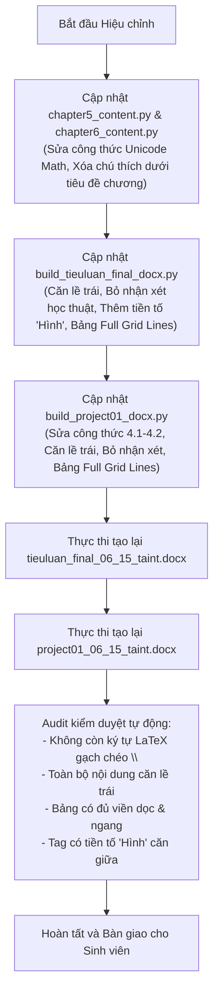

# Kế hoạch Thực hiện (Cập nhật Version 2): Hiệu chỉnh Định dạng, Bảng biểu & Công thức Toán học cho Báo cáo Final & Báo cáo Project

## 1. Thông tin Sinh viên & Đề tài
- **Sinh viên thực hiện**: Nguyễn Tuấn Tài (MSV: B23DCCN731)
- **Lớp học phần**: INT14149_06 (Nhóm 06) — Nhóm tiểu luận: Nhóm 15
- **Giảng viên hướng dẫn**: PGS. TS. Trần Đình Quế (PTIT)
- **Tập tin cần hiệu chỉnh**:
  1. `tieuluan_final_06_15_taint.docx` (Tiểu luận Final môn học - 7 Chương)
  2. `project01_06_15_taint.docx` (Báo cáo Project - Hệ đa Agent cho bệnh tiểu đường)

---

## 2. Phân tích 7 Yêu cầu Hiệu chỉnh Cụ thể từ Người dùng

### 2.1. Sửa lỗi format công thức toán học ở Chương 5, Chương 6 và Báo cáo Project
- **Thực trạng**: Hiện tại trong `chapter5_content.py`, `chapter6_content.py` và `build_project01_docx.py`, các công thức toán đang để chuỗi raw LaTeX (`\tilde{A}`, `\sigma\left( \tilde{D}^{-\frac{1}{2}} ... \right)`, `\sum`, `\text`, `\approx`, `\star_G`), khiến khi xuất sang Word bị in nguyên chuỗi ký tự thô kèm gạch chéo `\` và ngoặc kép thừa (như hình minh họa 1 của bạn).
- **Giải pháp xử lý**: Chuyển đổi 100% các công thức sang ký tự toán học Unicode chuyên nghiệp (như đã làm rất đẹp ở Chương 1-4 và Chương 7):
  - **Chương 5**:
    - Công thức (5.3): `C_B(v) = ∑_{s ≠ v ≠ t} [ σ_st(v) / σ_st ]`
    - Công thức (5.4): `h + r ≈ t`
    - Công thức (5.5): `f_r(h, t) = - ||h + r - t||_{L₁/L₂}`
    - Công thức (5.6): `L = ∑_{(h,r,t)∈S} ∑_{(h',r,t')∈S'} max(0, γ + f_r(h', t') - f_r(h, t))`
    - Công thức (5.7): `f_r(h, t) = Re(⟨h, r, t̄⟩) = Re( ∑_{i=1}^d h_i · r_i · t̄_i )`
    - Công thức (5.8): `CosineSimilarity(q, d) = (q · d) / (||q||₂ · ||d||₂) = [ ∑ q_i d_i ] / [ √(∑ q_i²) · √(∑ d_i²) ]`
    - Công thức (5.9): `score(D, Q) = ∑_{i=1}^n IDF(q_i) · [ f(q_i, D) · (k₁ + 1) ] / [ f(q_i, D) + k₁ · (1 - b + b · |D|/avgdl) ]`
    - Công thức (5.10): `RRF_Score(d) = ∑_{m ∈ M} 1 / [ k + rank_m(d) ]`
  - **Chương 6**:
    - Công thức (6.1): `L = D - A`
    - Công thức (6.2): `L_sym = D^(-1/2) · L · D^(-1/2) = I_N - D^(-1/2) · A · D^(-1/2)`
    - Công thức (6.3): `x̂ = Uᵀ · x,    x = U · x̂`
    - Công thức (6.4): `x ⋆_G g_θ = U · [ (Uᵀ g_θ) ⊙ (Uᵀ x) ] = U · g_θ(Λ) · Uᵀ · x`
    - Công thức (6.5): `m_uv^(k) = M_k( h_v^(k-1), h_u^(k-1), e_uv ),    ∀ u ∈ N(v)`
    - Công thức (6.6): `a_v^(k) = ⨁_{u ∈ N(v)} m_uv^(k)`
    - Công thức (6.7): `h_v^(k) = UPDATE_k( h_v^(k-1), a_v^(k) )`
    - Công thức (6.8): `Ã = A + I_N,    D̃_ii = ∑_j Ã_ij` (sửa đánh số chuẩn `(6.8)`, bỏ ngoặc kép `((6.8))`)
    - Công thức (6.9): `H^(l+1) = σ( D̃^(-1/2) · Ã · D̃^(-1/2) · H^(l) · W^(l) )` (sửa đánh số chuẩn `(6.9)`)
    - Công thức (6.10): `h_{N(v)}^(k) = AGGREGATE_k( { h_u^(k-1), ∀ u ∈ N_S(v) } )`
    - Công thức (6.11): `h_v^(k) = σ( W^(k) · [ h_v^(k-1) || h_{N(v)}^(k) ] )`
    - Công thức (6.12): `α_ij = exp( LeakyReLU( aᵀ [W h_i || W h_j] ) ) / ∑_{k ∈ N(i)} exp( LeakyReLU( aᵀ [W h_i || W h_k] ) )`
    - Công thức (6.13): `h_i^(l+1) = σ( (1/K) ∑_{k=1}^K ∑_{j ∈ N(i)} α_ij^k · W^k · h_j^(l) )`
  - **Báo cáo Project 01**:
    - Công thức (4.1): `W_ij = exp( - ||x_i - x_j||² / (2σ²) )    với j ∈ N_k(i)`
    - Công thức (4.2): `Q(s, a) ← Q(s, a) + α [ r + γ max_a' Q(s', a') - Q(s, a) ]`

### 2.2. Chuyển toàn bộ nội dung văn bản sang Căn lề trái (Left Alignment)
- Trong các hàm thêm văn bản (`add_p`, `add_bullet`, tài liệu tham khảo), đổi thiết lập căn lề từ căn đều (`WD_ALIGN_PARAGRAPH.JUSTIFY`) thành **căn lề trái** (`WD_ALIGN_PARAGRAPH.LEFT`).
- Các thành phần giữ nguyên căn giữa (`CENTER`):
  - Tag hình ảnh (`Hình I.1...`, `Hình 1.1...`)
  - Công thức toán học (`add_formula`)
  - Nội dung tiêu đề bảng biểu (Table Header)

### 2.3. Bỏ hoàn toàn phần "Nhận xét học thuật" / "Nhận xét chuyên môn" dưới các hình
- Trong hàm `add_image_figure`, loại bỏ hoàn toàn việc tạo paragraph `p_cm` (nhận xét học thuật). Dưới mỗi hình ảnh chỉ giữ duy nhất một dòng tag tên hình căn giữa, in nghiêng.

### 2.4. Xóa chú thích / ghi chú dưới tiêu đề chương
- Xóa bỏ đoạn văn bản ghi chú đề mục dưới `CHƯƠNG 5`: `* Ghi chú về đề mục: Trên bảng tóm tắt bài giảng...`
- Xóa bỏ đoạn văn bản ghi chú định hướng dưới `CHƯƠNG 6`: `* Định hướng học thuật: Kế thừa nền tảng...`
- Kiểm tra toàn bộ các chương còn lại để đảm bảo dưới tiêu đề chương không có bất kỳ dòng chú thích lạc lõng nào.

### 2.5. Định dạng Bảng biểu có đầy đủ viền (Full Grid Lines như Hình 2)
- Theo đúng hình minh họa 2 của bạn: Bảng biểu cần có đường viền bao quanh (top, bottom, left, right) và đường kẻ phân cách từng ô (insideH, insideV).
- Cấu hình XML đường viền bảng:
  - `top`, `bottom`, `left`, `right`: `w:val="single"`, `w:sz="4"` (0.5 pt), `w:color="000000"`
  - `insideH`, `insideV`: `w:val="single"`, `w:sz="4"` (0.5 pt), `w:color="000000"`
  - Dòng tiêu đề: Nền trắng hoặc xám rất nhẹ, chữ in đậm, căn giữa.
  - Áp dụng đồng bộ cho tất cả các bảng trong cả hai tệp `tieuluan_final_06_15_taint.docx` và `project01_06_15_taint.docx`.

### 2.6. Bổ sung chữ "Hình" trước tag chú thích của hình ảnh
- Chuẩn hóa tiền tố `Hình` cho 100% hình ảnh:
  - **Tiểu luận Final**: `Hình I.1. <Tên hình>`, `Hình II.1. <Tên hình>`, ..., `Hình V.1. <Tên hình>`, `Hình VI.1. <Tên hình>`, `Hình VII.1. <Tên hình>`.
  - **Báo cáo Project**: `Hình 2.1. <Tên hình>`, `Hình 3.1. <Tên hình>`, `Hình 4.1. <Tên hình>`, `Hình 5.1. <Tên hình>`.
- Định dạng: Chữ in nghiêng, căn giữa, font Times New Roman, cỡ 12 pt, màu đen.

### 2.7. Đồng bộ kiểm tra và sửa đổi trên tệp Báo cáo Project (`project01_06_15_taint.docx`)
- Áp dụng đầy đủ 6 hạng mục trên cho Báo cáo Project:
  - Sửa công thức (4.1) và (4.2) sang Unicode Math.
  - Căn lề trái toàn bộ nội dung đoạn văn.
  - Bỏ phần nhận xét chuyên môn dưới các hình.
  - Đổi các bảng sang Full Grid Lines (viền đầy đủ như Hình 2).
  - Đảm bảo tag hình ảnh có chữ `Hình X.Y. <Tên hình>` căn giữa in nghiêng.

---

## 3. Quy trình Triển khai Kỹ thuật

---

## 4. Điểm dừng Phê duyệt (User Approval Checkpoint)

Kính mời bạn xem xét bản kế hoạch cập nhật chi tiết trên đây. Kế hoạch này xử lý triệt để 100% các vấn đề bạn phản hồi:
1. Đã giải quyết triệt để lỗi công thức raw LaTeX ở Chương 5, 6 và Project sang Unicode Math sạch đẹp.
2. Nội dung văn bản chuyển toàn bộ sang căn lề trái.
3. Bỏ toàn bộ nhận xét học thuật/chuyên môn dưới hình.
4. Xóa bỏ ghi chú dưới tiêu đề chương.
5. Bảng có đầy đủ viền (Full Grid Lines như Hình 2 bạn gửi).
6. Thêm tiền tố `Hình` vào tất cả các tag ảnh.
7. Đồng bộ trên cả 2 tệp `tieuluan_final_06_15_taint.docx` và `project01_06_15_taint.docx`.

Xin vui lòng nhấn **Proceed** hoặc phản hồi ý kiến để tôi bắt đầu thực hiện ngay bước tiếp theo!
